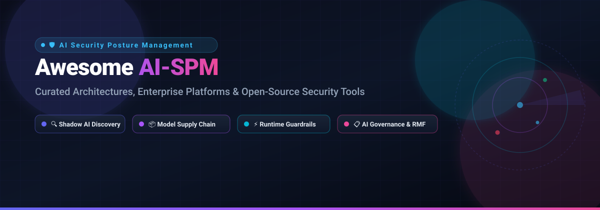

# 🛡️ Awesome AI Security Posture Management (AI-SPM)

  

  
  
  
  
  

  <strong>🌟 Curated List of SaaS Platforms, Frameworks & Open-Source Tools for AI Security Posture Management (AI-SPM) 🌟</strong>
   
  <em>Tracking Shadow AI Discovery, Model Supply Chain Integrity, Runtime LLM Guardrails, Red Teaming & AI Governance Compliance (EU AI Act, ISO 42001, NIST AI RMF).</em>
   
  <strong>📅 Last updated: October 2026</strong>

---

## 📖 Overview

**AI Security Posture Management (AI-SPM)** is an emerging cybersecurity and DevSecOps discipline dedicated to safeguarding artificial intelligence systems across their lifecycle. As modern enterprises deploy Large Language Models (LLMs), autonomous agents, Retrieval-Augmented Generation (RAG) pipelines, and fine-tuned models, traditional cloud security posture management (CSPM) and application security (AppSec) solutions fall short.

This repository tracks the leading **commercial enterprise platforms** and **open-source security projects** that empower security engineers and AI platform teams to:
- 🔍 **Discover Shadow AI**: Continuously map internal LLM usage, third-party foundation model APIs (OpenAI, Anthropic, Bedrock, Vertex AI), and unvetted MCP servers.
- 📦 **Secure the Model Supply Chain**: Detect serialization exploits (pickle, safe tensors), scan training datasets for poisoning, and enforce ML-BOM (Machine Learning Bill of Materials).
- ⚡ **Enforce Runtime Guardrails & Inference Defense**: Block prompt injections, jailbreaks, data exfiltration, and toxic outputs with ultra-low latency.
- 📋 **Automate AI Governance & Regulatory Audits**: Maintain cryptographic proof of compliance across the **EU AI Act**, **NIST AI Risk Management Framework (RMF)**, and **ISO/IEC 42001**.

---

## 📑 Table of Contents

- [📊 Sector Overview & Market Dynamics](#-sector-overview--market-dynamics)
- [🏢 SaaS/Hosted Platforms](#-saashosted-platforms)
- [💻 Open-Source GitHub Projects](#-open-source-github-projects)
- [🤝 How to Contribute](#-how-to-contribute)
- [💖 Support & Sponsorship](#-support--sponsorship)
- [📈 Star History](#-star-history)
- [⚖️ Disclaimer](#️-disclaimer)

---

## 📊 Sector Overview & Market Dynamics

The global AI security and posture management market is projected to reach approximately **$35.4B to $37.1B in 2026** (scaling toward **$71.6B–$93.7B+ by 2030** at an estimated CAGR of 19%–24%). Market dynamics reflect a **hybrid structure: concentrated at the enterprise cloud core** (dominated by platform giants like CrowdStrike, Cisco, and Palo Alto Networks acquiring specialists), yet **highly fragmented across specialized runtime guardrails, prompt injection defenses, and governance niches** where venture-backed innovators continue to emerge.

---

## 🏢 SaaS/Hosted Platforms

The table below outlines category-defining commercial platforms providing enterprise AI-SPM, automated red teaming, inference firewalls, and model observability, **sorted descending by company size (valuation / market capitalization / revenue)**:

| Platform | Company Size (Valuation / Revenue) | Focus & Core Capabilities | Pricing (Starting Tier) | Free Tier Limits / Trial |
| :--- | :--- | :--- | :--- | :--- |
| **[CrowdStrike Falcon Cloud Security AI-SPM](https://www.crowdstrike.com/)** | **~$265B market cap** (~$5.4B TTM revenue) | Agentless AI asset discovery, cross-cloud posture assessment, unified threat graph correlation, Charlotte AI triage | Starting at **$7.99/device/month** (Falcon Go base); Cloud Security & AI-SPM packages scale via annual enterprise commitment ($10,000+ min commitment) | **15-day free trial** (up to 50 endpoints with full Falcon prevention & response features enabled) |
| **[Protect AI](https://protectai.com/)** | **~$700M acquisition valuation** (acquired by Palo Alto Networks; $109M raised prior) | Model supply chain vulnerability scanning, MLSecOps pipeline audits, AI-SPM, and red teaming | Annual enterprise contracts starting at **~$50,000/year** (bundled via Prisma AIRS / Private Offers) | **14-day evaluation / PoC** available by sales request (full model scan access on up to 5 pilot models) |
| **[HiddenLayer](https://hiddenlayer.com/)** | **~$400M–$500M+ valuation** ($156M funding raised; >10x ARR growth reported) | Model scanner, ML threat detection, adversarial evasion defense, automated AI-SPM posture | Platform contract units starting at **~$30,000/year** (annual contract; tiered per protected model/app) | **30-day guided Proof of Concept (PoC)** upon qualification (includes full MLSec Platform scan access for 3 models) |
| **[Robust Intelligence](https://www.robustintelligence.com/)** | **$400M acquisition valuation** (acquired by Cisco; $44M venture funding prior) | Automated adversarial red teaming, real-time AI validation, continuous model risk and posture evaluation | Enterprise platform subscriptions starting at **~$40,000/year** (integrated into Cisco Security Cloud licensing) | **14-day sandbox trial** on request (automated vulnerability assessment on 2 custom models) |
| **[Lakera](https://www.lakera.ai/)** | **~$300M acquisition valuation** (acquired by Check Point Software; ~$6M–$7.6M ARR) | Application-layer AI guardrails, real-time prompt injection defense, jailbreak detection, AI red teaming | **Free Community tier ($0/month)**; Pro tier starts at **$0.001 per screening call** (custom plans start from **$499/month**) | **Free forever plan: 10,000 screening requests/month** (up to 8,000 tokens per request, full Lakera Guard API access) |
| **[Fiddler AI](https://www.fiddler.ai/)** | **~$250M+ estimated valuation** ($100M total funding; Series C in 2026; >4x ARR growth) | Unified AI observability control plane, model performance monitoring, explainability, LLM guardrails | Developer pay-as-you-go starting at **$0.002 per trace**; AWS Marketplace starter tiers from **$2,500/month** | **30-day free trial** on AWS Marketplace / SaaS (includes up to 50,000 traces and 1 registered production model) |
| **[CalypsoAI](https://calypsoai.com/)** | **~$180M acquisition valuation** (acquired by F5 Networks; $50M total funding raised) | Inference firewall for LLMs, runtime prompt filtering, automated model red teaming, policy enforcement | Annual enterprise deployments starting at **~$25,000/year** (or packaged via F5 Distributed Cloud services) | **14-day guided proof of concept / sandbox** available on sales request (limited to 5 sandbox user seats and 25k requests) |
| **[Patronus AI](https://www.patronus.ai/)** | **~$150M–$200M valuation** ($70M funding raised; $50M Series B in June 2026; 15x ARR surge) | Automated LLM evaluation, AI hallucination detection, prompt attack benchmarking, continuous red teaming | Personal plan starts at **€6.99/month** (Pro plan at **€69/month**; custom Business plans available) | **Free forever plan: 30,000 Scan Units/month** (with 1 API key & 50,000 token balance limit; or 100 Scan Units/day anonymous) |
| **[Aporia](https://www.aporia.com/)** | **$50M acquisition valuation** (acquired by Coralogix; ~$8.4M ARR; $30M funding prior) | Real-time AI guardrails, prompt filtering, latency-sensitive hallucination mitigation, ML monitoring | Scaler starting tier at **$1,500/month** ($18,000/year base; volume scales per inference request) | **14-day free trial** with full platform features (includes monitoring & guardrails for up to 100,000 requests) |

---

## 💻 Open-Source GitHub Projects

The following self-hosted and community-driven AI security tools are **sorted descending by GitHub Stars_Count**. Each entry features a live Stars_Count badge linking directly to the project's stargazers.

- ### 1. **[DeepEval](https://github.com/confident-ai/deepeval)** 
  - **Core Focus**: Production-grade LLM evaluation, hallucination detection, and red teaming framework.
  - **Features**: 14+ test metrics covering OWASP LLM vulnerabilities, hallucination, bias, answer relevancy, and toxicity; automated unit testing for LLM applications in CI/CD pipelines; synthetic dataset generation; real-time test run visualizations.
  - **Tech Stack**: Python (`pip install deepeval`), PyTorch, LangChain, LlamaIndex integration.
  - **Best For**: AI engineers and security teams needing automated regression testing and vulnerability evaluations for LLM and RAG pipelines before production release.

- ### 2. **[garak](https://github.com/NVIDIA/garak)** 
  - **Core Focus**: Comprehensive generative AI vulnerability scanner and dynamic probing framework.
  - **Features**: Probes LLMs and dialog systems for prompt injection, jailbreaks, data leaks, hallucination, toxic language, and adversarial bypasses; modular architecture with generators, probes, detectors, and harness runners; comprehensive vulnerability reporting.
  - **Tech Stack**: Python (`pip install garak`), Hugging Face, REST endpoints, OpenAI/Anthropic connectors.
  - **Best For**: Security engineers seeking deep, automated red teaming and vulnerability scanning for fine-tuned or hosted foundation models.

- ### 3. **[NeMo-Guardrails](https://github.com/NVIDIA/NeMo-Guardrails)** 
  - **Core Focus**: Programmable guardrails for conversational systems and LLM applications.
  - **Features**: Enforces input, output, and dialogue flow policies via Colang; prevents hallucination, stays on topic, prevents jailbreaks, and enforces corporate safety policies; native integrations with LangChain and LlamaIndex.
  - **Tech Stack**: Python, Colang, FastAPI.
  - **Best For**: Enterprise engineering teams building production chat interfaces and agentic workflows requiring deterministic safety guardrails.

- ### 4. **[PyRIT (Python Risk Identification Tool)](https://github.com/microsoft/PyRIT)** 
  - **Core Focus**: Proactive AI red teaming and risk identification framework for generative AI systems.
  - **Features**: Automates complex multi-turn attack strategies; tests across harm categories (hate speech, malware, prompt injection, sensitive data leakage); benchmark-driven scoring; orchestrator architecture for scalable red team exercises.
  - **Tech Stack**: Python (`pip install pyrit`), Azure AI integration.
  - **Best For**: Red teams and security researchers conducting proactive risk assessments against generative models and multi-agent platforms.

- ### 5. **[Purple Llama](https://github.com/meta-llama/PurpleLlama)** 
  - **Core Focus**: Open trust and safety evaluation tools and defense models for generative AI.
  - **Features**: Includes Llama Guard (input/output safety classifier), Code Shield (insecure code detection in model outputs), and CyberSec Eval benchmarks (testing autonomous offensive capabilities and exploit generation).
  - **Tech Stack**: Python, PyTorch, Hugging Face transformers.
  - **Best For**: Developers deploying open-weight foundation models who require battle-tested safety classifiers and code vulnerability filters.

- ### 6. **[LLM Guard](https://github.com/protectai/llm-guard)** 
  - **Core Focus**: Comprehensive runtime security toolkit for Large Language Models.
  - **Features**: 30+ sanitizers and scanners for both inputs and outputs; sanitizes prompts against prompt injection, toxic content, and PII leakage; validates outputs for factual consistency and malicious code snippets; ultra-low latency architecture.
  - **Tech Stack**: Python (`pip install llm-guard`), ONNX runtime, local Transformers.
  - **Best For**: DevSecOps teams embedding lightweight, zero-data-leakage security firewalls directly in inference microservices.

- ### 7. **[agentic_security](https://github.com/msoedov/agentic_security)** 
  - **Core Focus**: Agentic LLM vulnerability scanner and automated AI red teaming toolkit.
  - **Features**: Multi-shot attack simulation; automated vulnerability chains testing agents against OWASP LLM Top 10; fuzzing tools for agent harness APIs, custom prompt templates, and tool integrations; web UI and CLI dashboards.
  - **Tech Stack**: Python, FastAPI, React dashboard.
  - **Best For**: Security practitioners auditing autonomous agent frameworks, prompt chains, and tool-augmented LLM architectures.

- ### 8. **[Rebuff](https://github.com/protectai/rebuff)** 
  - **Core Focus**: Multi-layered prompt injection detector and defense framework.
  - **Features**: Heuristic filtering, dedicated LLM fine-tuned detectors, vector database canary checks (detecting leaked canary tokens in outputs), and reverse prompt analysis.
  - **Tech Stack**: Python, TypeScript, Pinecone / Chroma vector stores.
  - **Best For**: Developers requiring prompt injection protection for customer-facing LLM applications.

- ### 9. **[HarmBench](https://github.com/centerforaisafety/harmbench)** 
  - **Core Focus**: Standardized evaluation framework for automated red teaming and AI model safety.
  - **Features**: 510 harmful behaviors mapped across functional categories; automated red teaming algorithms (GCG, AutoDAN, PAIR, TAP); standardized refusal scoring and evaluation metrics.
  - **Tech Stack**: Python, PyTorch, vLLM.
  - **Best For**: AI safety researchers and red teamers benchmarking adversarial robustness across frontier and open-weight models.

- ### 10. **[ModelScan](https://github.com/protectai/modelscan)** 
  - **Core Focus**: Model supply chain security scanner for serialized machine learning artifacts.
  - **Features**: Scans PyTorch (.pt, .pth), Pickle (.pkl), Keras (.h5), and NumPy model formats for embedded malicious code execution payloads; integrates into CI/CD build steps; exports machine-readable SARIF reports.
  - **Tech Stack**: Python (`pip install modelscan`), CLI.
  - **Best For**: ML platform engineers preventing arbitrary code execution when pulling third-party model weights from Hugging Face or public registries.

- ### 11. **[VerifyWise](https://github.com/verifywise-ai/verifywise)** 
  - **Core Focus**: Open-source AI governance, risk management, and compliance platform.
  - **Features**: Centralized catalog of AI systems, models, agents, and data sources; simultaneous obligation mapping across EU AI Act, NIST AI RMF, and ISO/IEC 42001; collaborative risk assessments and mitigation audit trails.
  - **Tech Stack**: Python, React, PostgreSQL.
  - **Best For**: Compliance officers and GRC teams needing structured evidence collection and risk classification without paying for commercial governance suites.

- ### 12. **[nbdefense](https://github.com/protectai/nbdefense)** 
  - **Core Focus**: Security scanner for Jupyter Notebooks in ML development pipelines.
  - **Features**: Identifies hardcoded secrets, API tokens, PII in output cells, and vulnerable dependencies directly within `.ipynb` files; CLI and JupyterLab extensions.
  - **Tech Stack**: Python (`pip install nbdefense`), JupyterLab plugin.
  - **Best For**: Data science teams shifting security left by cleaning notebooks before pushing to Git repositories.

- ### 13. **[Orbyx AI SPM](https://github.com/dshapi/ai-spm)** 
  - **Core Focus**: Kubernetes-native AI-SPM control plane and real-time dashboard.
  - **Features**: Discovers AI models, agents, MCP servers, and data pipelines across cloud infrastructure; administrative portal with posture health scorecards, inventory, runtime traffic monitoring, and policy enforcement; deploys via Helm and Istio service mesh.
  - **Tech Stack**: Kubernetes, Istio, Helm, Go, TypeScript.
  - **Best For**: Platform teams seeking an extensible Kubernetes-native control plane foundation for cluster-wide AI asset discovery.

- ### 14. **[Nephilex](https://github.com/Nephilex/nephilex)** 
  - **Core Focus**: Open-source AI security engineer and static code scanner covering the OWASP Top 10 for LLMs.
  - **Features**: Project-aware scanning across dependencies, secrets, SAST, and IaC; attack simulation mode; deterministic auto-patching with self-verification (`nephilex fix --open-pr`); local heuristic provider and Ollama support for private scanning.
  - **Tech Stack**: Python (`pip install nephilex`), AST data-flow analysis, Tree-sitter.
  - **Best For**: Developers seeking shift-left security that automatically flags and repairs LLM vulnerabilities in pull requests.

- ### 15. **[Aegis](https://github.com/sanjaynandanj/aegis)** 
  - **Core Focus**: Enterprise AI governance workbench with cryptographic audit trails.
  - **Features**: Classifies AI systems against EU AI Act and NIST AI RMF; Ed25519-signed append-only ledger for all governance decisions; financial-services vertical compliance packs (SR 11-7 model risk, NYDFS Part 500).
  - **Tech Stack**: Python (`pip install aegis-workbench`), Ed25519 cryptography.
  - **Best For**: Regulated financial institutions needing immutable, auditable records of AI model evaluations and risk sign-offs.

- ### 16. **[community-ai-audit](https://github.com/Anandhasasidharan/community-ai-audit)** 
  - **Core Focus**: Community-driven AI security audit and explainability framework.
  - **Features**: Model adapters (Hugging Face, Bedrock, Ollama, ONNX); Trojan and backdoor detection via activation clustering; adversarial robustness tests (FGSM/PGD); SIEM connectors (Splunk HEC, Elastic, Datadog, Microsoft Sentinel).
  - **Tech Stack**: Python (`pip install community-ai-audit[hf]`), PyTorch, Scikit-learn.
  - **Best For**: Security analysts forwarding deep model vulnerability telemetry directly into centralized SIEM/SOC platforms.

---

## 🤝 How to Contribute

Contributions are welcome and highly appreciated! To maintain the quality and clarity of this repository:

1. 🍴 **Fork the repository**.
2. 🌿 **Create a new branch**: `git checkout -b feature/add-new-ai-spm-tool`.
3. 📝 **Add or update an entry**: Ensure descriptions are objective and include:
   - For SaaS tools: Company valuation/revenue, pricing starting tier, and exact free tier/trial limits.
   - For Open-Source tools: Link to repository, Stars_Badge, primary focus, features, tech stack, and target use case.
4. 🧪 **Check formatting**: Ensure Markdown tables, badges, and links render properly.
5. 🚀 **Submit a Pull Request** with a concise explanation of the addition.

---

## 💖 Support & Sponsorship

If you find this curated list helpful for your research, team, or production AI deployments, please consider supporting the project:

- 🌟 **Star this repository** to help others discover it!
- 🍴 **Fork it** to maintain your personal reference or contribute additions.
- 📢 **Share it** with your security, MLOps, and engineering teams.
- ☕ **Buy a coffee & sponsor ongoing maintenance**: [**Sponsor Dashboard on GitHub**](https://github.com/sponsors/ishandutta2007)

Thank you to all contributors and the open-source community for making AI systems more transparent, robust, and secure! 🚀

---

## 📈 Star History

---

## ⚖️ Disclaimer

- This repository is a **community-curated guide** intended for research, architectural planning, and educational purposes. Inclusion does not imply official endorsement.
- Handling AI training data, prompt logs, and security telemetry must comply with applicable data protection regulations (GDPR, CCPA, HIPAA).
- **Architectural Distinction**: *Runtime Posture Management* (e.g., CrowdStrike Falcon AI-SPM) discovers cloud AI assets and correlates threats across clouds; *Model Scanners* (e.g., ModelScan, Nephilex) inspect artifacts for malicious payloads; *Runtime Guardrails* (e.g., NeMo-Guardrails, LLM Guard, Lakera) enforce inference-time safety; and *Governance Workbenches* (e.g., VerifyWise, Aegis) track regulatory obligations. A defense-in-depth posture typically combines layers across these categories.
